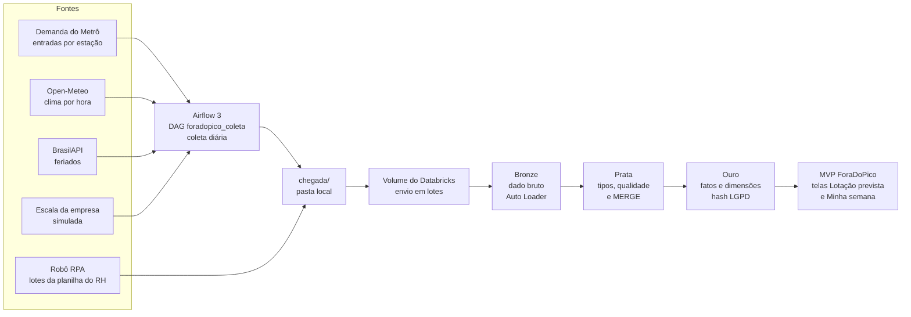

# ForaDoPico · Big Data Architecture & Data Integration

**Global Solution 2026.2 · CitizenTech · FIAP, Engenharia de Software, 4º ano (turma 4ESPW)**

O **ForaDoPico** é uma plataforma de escala presencial inteligente: a empresa informa quantas pessoas precisa no
escritório em cada dia, e o app monta a escala escolhendo dias e horários de entrada que tiram os funcionários do
horário de pico do Metrô. Este repositório contém o **pipeline de dados** do produto: coleta no Airflow e camadas
Bronze, Prata e Ouro no Databricks, até as tabelas que o app lê.

## Integrantes

| Nome | RM |
| --- | --- |
| João Saborido | 98184 |
| Matheus Haruo | 97663 |
| Pedro Guerra de Souza Freitas | 99526 |
| Victor Wittner | 98667 |

## Perguntas que o MVP responde

1. Quais estações são as mais movimentadas em dia útil, e em que horário elas lotam?
2. Para quem embarca numa estação, qual a melhor janela de entrada no escritório?
3. Em qual dia da semana é mais tranquilo ir ao escritório?
4. Quanto o movimento cai em feriados, emendas e fins de semana?
5. **Impacto:** quanto a escala sugerida tira os funcionários do pico, em relação à escala original da empresa?

## Arquitetura



O Databricks Free Edition não se conecta ao Airflow: os arquivos da pasta `chegada/` sobem ao Volume pela interface,
em lotes de dias de coleta diferentes.

## Fontes de dados

| Fonte | Tipo | Formato | Frequência de coleta | Papel |
| --- | --- | --- | --- | --- |
| Demanda do Metrô de SP: entradas diárias por estação ([portal de transparência](https://transparencia.metrosp.com.br/dataset/demanda), consolidado em CSV pelo projeto [metrosp](https://github.com/viniciusoike/metrosp), licença MIT) | Externa, dado aberto | CSV | Diária (DAG) | Fonte principal |
| [Open-Meteo](https://open-meteo.com/): temperatura e chuva por hora em São Paulo (CC BY 4.0) | Externa, API sem chave | JSON | Diária (DAG) | Chuva no horário de embarque |
| [BrasilAPI](https://brasilapi.com.br/): feriados nacionais do ano | Externa, API sem chave | JSON | Diária (DAG) | Feriados e emendas |
| Escala presencial da empresa | Interna, **simulada** (nomes e e-mails inventados) | CSV | Diária (DAG) | Escala original do RH |
| Lotes do robô RPA (planilha do RH validada e pseudonimizada) | Interna | JSON | A cada planilha nova | Regras da escala da semana |

## Estrutura do repositório

```
dags/
  foradopico_coleta.py      DAG de coleta (Airflow 3)
databricks/
  01_bronze.py              Auto Loader incremental e contagens
  02_prata.py               tipos, regras de qualidade, quarentena e MERGE
  03_ouro.py                dimensões, fatos, LGPD, as 5 consultas e as views do app
  04_integracao_rpa.py      lotes do robô RPA
amostras/                   um arquivo de cada fonte, como chega na pasta chegada/
README.md
```

## Como reproduzir

### 1. Coleta com o Airflow

Pré-requisitos: Docker Desktop (com WSL2 no Windows) e pelo menos 4 GB de memória para o Docker.

1. Na pasta do projeto, baixe o arquivo oficial do Airflow 3.3.1 e crie as pastas:
   ```bash
   curl -LfO "https://airflow.apache.org/docs/apache-airflow/3.3.1/docker-compose.yaml"
   mkdir dags logs plugins config chegada
   echo "AIRFLOW_UID=50000" > .env
   ```
2. No `docker-compose.yaml`, dentro de `x-airflow-common`:
   - troque `AIRFLOW__CORE__LOAD_EXAMPLES` para `'false'`;
   - em `volumes:`, acrescente `- ${AIRFLOW_PROJ_DIR:-.}/chegada:/opt/airflow/chegada`.
3. Copie `dags/foradopico_coleta.py` para a pasta `dags/` e suba o Airflow:
   ```bash
   docker compose up airflow-init
   docker compose up -d
   ```
4. Em `http://localhost:8080`, menu **Admin > Variables**, cadastre:

   | Key | Val |
   | --- | --- |
   | `FORADOPICO_LATITUDE` | `-23.55` |
   | `FORADOPICO_LONGITUDE` | `-46.63` |
   | `FORADOPICO_LINHAS` | `1,3` |
   | `FORADOPICO_DEMANDA_INICIO` | `2026-01-01` |

   Opcional: `FORADOPICO_WEBHOOK_URL` (aviso de falha num webhook, como o do Discord).
5. Ative o DAG `foradopico_coleta`. Com `catchup=True`, ele roda um dia de cada vez desde 01/11/2026 e grava
   um arquivo por fonte e por dia em `chegada/<fonte>/<fonte>_AAAA-MM-DD.<ext>`.

O DAG coleta as 4 fontes **em paralelo** e termina com a tarefa `conferir_chegada`, que falha se algum arquivo do
dia não chegou. As configurações ficam em Variables, nunca no código.

### 2. Camadas no Databricks Free Edition

1. Importe os notebooks da pasta `databricks/` (Workspace > Import).
2. Rode a seção 1 do `01_bronze`: ela cria o schema `workspace.foradopico` e os volumes `chegada` e `controle`.
3. **Lote 1:** envie os arquivos de 01 a 05/11 para `chegada/<fonte>/` no Volume e rode o `01_bronze` com o
   campo `etapa = 1_lote1`.
4. **Lote 2:** envie os arquivos de 06 a 11/11 e rode com `etapa = 2_lote2`. Depois rode de novo, sem enviar nada,
   com `etapa = 3_reexecucao`: as contagens não mudam.
5. Rode o `02_prata` duas vezes: na segunda execução o MERGE mostra 0 inseridos e 0 atualizados.
6. Rode o `03_ouro`.
7. Para a integração com o RPA, envie os lotes JSON do robô para `chegada/schedule/` e rode o `04_integracao_rpa`.

## Camadas

| Camada | Tabelas | O que faz |
| --- | --- | --- |
| Bronze | `bronze_demanda_metro`, `bronze_clima`, `bronze_feriados`, `bronze_escala` | Dado bruto com `arquivo_origem` e `carregado_em`. Auto Loader com checkpoint: só arquivos novos entram |
| Prata | `prata_demanda_metro`, `prata_clima`, `prata_feriados`, `prata_escala`, `prata_estacao`, `prata_empresa` | Tipos corretos, nomes de estação padronizados, 9 regras de qualidade com quarentena e MERGE pela chave |
| Ouro | `dim_data`, `dim_estacao`, `dim_faixa_horaria`, `dim_funcionario`, `fato_lotacao`, `ouro_lotacao_prevista`, `fato_viagem_escala` | Modelo dimensional, as 5 consultas e as views do app |

**O que o app usa:** `vw_app_lotacao_prevista` (tela Lotação prevista) e `vw_app_minha_semana` (tela Minha semana).
Nenhuma das duas tem nome, e-mail ou id do funcionário.

## LGPD

- Nome e e-mail existem só até a Prata. Na Ouro, o funcionário vira `funcionario_chave` (SHA-256 do id com um salt
  secreto, truncado), o nome vira `nome_mascarado` (só as iniciais) e o e-mail vira `email_hash`.
- O salt é gerado na primeira execução e fica no volume `controle` do Databricks: não está no código nem neste repositório.
- Os lotes do robô RPA já chegam pseudonimizados, sem nome nem e-mail.
- A escala usada nos testes é **fictícia**: nenhum dado pessoal real foi usado.

## Hipóteses e limitações

- **Lotação por horário estimada:** o Metrô publica o total diário de entradas por estação. A lotação a cada 15 minutos
  distribui esse total por um perfil horário (picos às 7h e às 18h), documentado na `dim_faixa_horaria`. O perfil pode
  ser trocado por dados horários reais, como a contagem de pessoas por visão computacional.
- **Embarque:** o app considera que o funcionário embarca 1 hora antes da entrada no escritório.
- **Escala sugerida:** as janelas permitidas são 07:00, 08:00, 09:30 e 10:30, com no máximo 40% do time na mesma janela
  e rodízio diário.
- O MVP cobre as Linhas 1-Azul e 3-Vermelha e os dados de demanda de janeiro a setembro de 2026.
